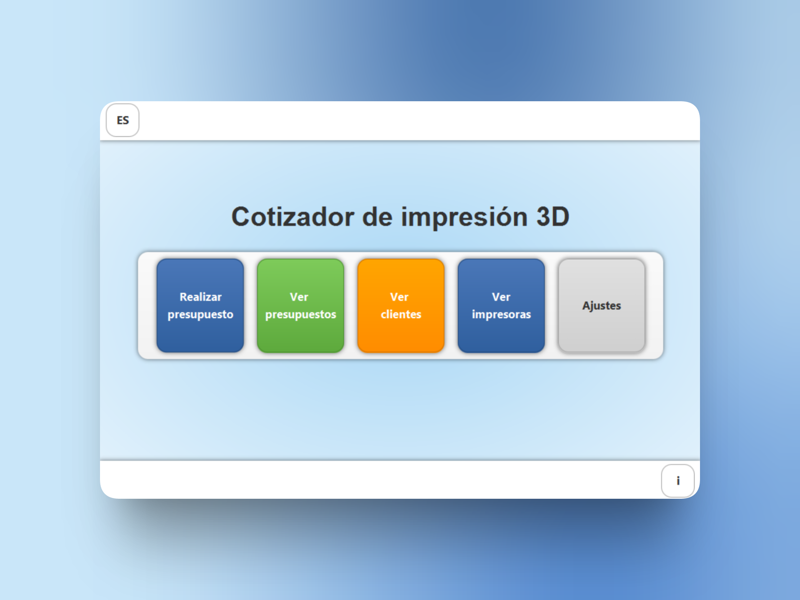

# Cotizador de Impresiones

## Sobre el proyecto
Este proyecto consiste en una aplicación de escritorio desarrollada en **Java**, diseñada para facilitar la gestión de un local de impresión 3D.

La aplicación cuenta con las siguientes funciones:

- **Datos del local:** permite registrar y administrar la información del propietario y del establecimiento.
- **Gestión de impresoras:** permite administrar las impresoras disponibles para realizar los trabajos.
- **Gestión de clientes:** permite registrar y consultar la información de los clientes.
- **Presupuestos y facturas:** permite crear presupuestos y generar facturas según las características de cada pedido.
- **Historial de operaciones:** permite consultar los presupuestos y las facturas realizadas en el local.

Para calcular los presupuestos, la aplicación tiene en cuenta distintos factores, como los costos de impresión, los materiales necesarios, la cantidad de piezas solicitadas y el tiempo estimado de trabajo. Esto permite calcular precios más precisos y adaptados a las necesidades de cada cliente.

El objetivo del proyecto es **simplificar y organizar las tareas diarias de un local de impresión 3D**, reuniendo en una sola aplicación las herramientas necesarias para administrar sus operaciones.

Además, la aplicación cuenta con **soporte para los idiomas español e inglés**, lo que permite utilizarla en ambos idiomas.

## Hecho con
- Java
- JavaFX
